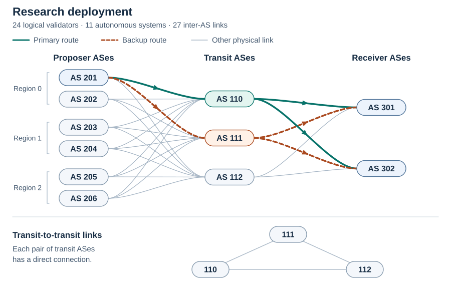

# Who Proposes Together? Path-Aware Geo Scheduling for MCP

This repository contains the scheduling simulations and SCION testbed used in the paper. The simulations generate validator populations. The testbed sends proposals between containers and records when two observers receive them. You can run the simulations and the testbed independently. Figure 1 illustrates the scheduling procedure, and Table 3 gives a worked example.

## Setup

Use Linux, Python 3.12 with `venv` and `pip`, and GNU Make. Open a terminal in the repository and run:

```sh
python3.12 -m venv .venv
. .venv/bin/activate
python -m pip install -r requirements-simulation.txt
```

## Scheduling simulations

| Run from the repository root | What it does |
| --- | --- |
| `make simulate` | Compares geographic and local schedules (Figure 2), varies transit and backup routes (Figure 5), and reports solver performance and service limits (Tables 4 and 5). |
| `make figure2` | Redraws Figure 2 from the per-seed scores saved by `make simulate` in `results/figure2-exposure.csv`. |
| `make hosting` | Plots hosting-ASN concentration and capacity thresholds (Figure 4) from a current Validators.app snapshot. |
| `make ripe` | Repeats the public-routing comparison in Appendix F using a fresh RIPE Atlas and RIPEstat sample. |

Look in `results/` for simulation results, `figures/` for plots, and `data/` for public downloads. For each outage, `exposure_max_by_scenario` gives the largest number of proposers affected in any round. Entries follow the instance’s outage catalogue.

Use `make public-data` for both public analyses. The paper used historical snapshots, so a fresh download can give different values. If Validators.app declines the download, open the URL printed in the terminal, save the page as HTML, and run `make hosting ASN_HTML=/path/to/saved-page.html`.

## SCION experiments

Use an idle x86-64 Linux host with Git, Bash, and Docker configured to run privileged containers. With the Python environment active, install the plotting tools once:

```sh
python -m pip install -r experiments/scion-localnet/requirements-report.txt
```

Run **all SCION experiments** from the repository root. The runner downloads the pinned SCION tools on first use, starts and stops the containers, and prints the report directories.

```sh
make scion
```

If you only need a particular result, choose its command below.

**Tables 1 and 6, Figure 6.** The 36-validator testbed measures how many proposals reach both observers by each cutoff during a transit outage (Table 1) and how many rounds have zero timely proposals (Table 6). A separate workload measures how long three proposers take to exchange all six peer messages (Figure 6).

```sh
make table1
```

The report saves the proposal receipt times in `recorded-delivery.csv` and the peer timing statistics in `peer-summary.csv`. Running `make figure6` starts the same experiment.

**Tables 2 and 7.** How many proposals from a round arrive when one hosting provider or transit network fails? This experiment compares two ways to group the same validator turns. One balances the busiest transit network alone. The other also accounts for shared hosting and the remaining transit networks.

```sh
make paired-outages
```

For each rule, the runner replays the same 72 rounds under four separate outages, one for each of three hosting providers and one for the busiest transit network. The report writes the hosting distribution to `paired-hosting-distribution.tex` and the deadline comparison to `paired-outage-delivery.tex`. The counts for each outage are in `paired-outage.csv`.

**Figure 3.** How many regions can the proposers cover at each delay limit in the 24-validator testbed?

```sh
make figure3
```

**Route-model check (Appendix G).** The pilot compares predicted and observed proposal losses beyond the first miss in each round during a transit outage. Its report records both counts in `results.csv`.

```sh
make pilot-validation
```

## Testbed topology



[Both testbed diagrams and how to read them](experiments/scion-localnet/README.md)
