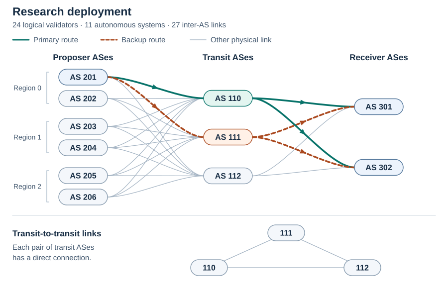
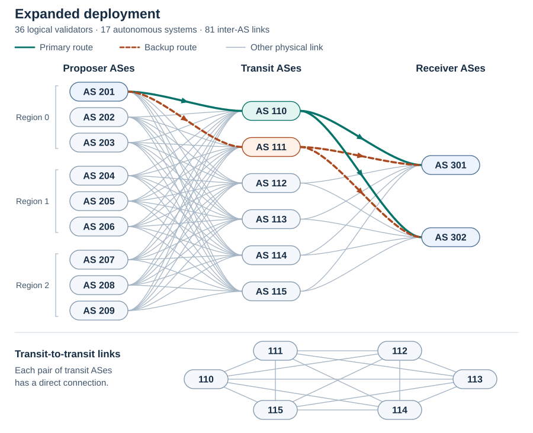

# SCION testbed architecture

[Setup and experiment commands](../../README.md#scion-experiments)

Each node is one SCION autonomous system (AS) running in its own container. Each line joins two ASes connected by a link in the deployment. Read the highlighted routes from left to right, from a proposer through its selected transit network to the two receivers.



The pilot diagram shows how validator `v03` in **AS 201** can reach the receivers in **AS 301** and **AS 302**. Solid green arrows trace the primary routes through **AS 110**, dashed orange arrows trace backups through **AS 111**, and gray lines show the remaining links. The lower panel shows how the transit networks connect to each other.



The expanded example shows the same choice of transit for `v02` in AS 201. Both deployments use three emulated regions in one isolation domain. The [traffic program](cmd/mcp-traffic/main.go) runs inside the containers. Proposers use it to send test payloads, and the two receivers use it to record when each complete payload arrives. In the peer-timing experiment, proposers also send messages to one another.

For Table 1, the local baseline preserves the original groups. The best-effort rule aims for at most one proposer per round on the shared transit network. The strict rule allows at most two. All three schedules preserve validator turns, hub order, and the delay limit between proposers.

The pilot sends 100 round-trip probes per path and the expanded testbed sends 50. A proposer pair qualifies when each direction has a path where every probe returned and the 95th-percentile round-trip time meets the limit.

## How delivery is counted

Each row of the generated `recorded-delivery.csv` represents one scheduled proposal. Its last two columns give the time in nanoseconds from the start of the round until each receiver verified the complete payload. A blank cell means that receiver recorded no verified receipt.

The delivery tables count a proposal once both receivers have verified it. Table 1 pools three local runs and applies the 220, 500, and 750 ms cutoffs to the same receipts. Table 6 counts rounds in which none of the three proposals reached both observers by 750 ms, for local and geographic groups.

Tables 2 and 7 compare two ways to group three proposers in the same hub. The first aims for at most two on the busiest transit network. The second adds a target of one per hosting provider and one per other transit network.

For Table 2, we replay the same 72 rounds under three separate hosting outages. In each outage, one provider goes offline across all hubs. Each column counts how many of the 216 round replays delivered exactly that many proposals to both receivers by 750 ms. Table 7 gives counts at each deadline and includes a separate transit outage. The report gives counts by outage in `paired-outage.csv` and by seed in `paired-outage.json`.

## Report files

Each experiment prints the path to its `batch/report/` directory.

| Paper item | Report file |
| --- | --- |
| Figure 3. Geographic reach | `geographic-reach.pdf` |
| Table 1. Local delivery by receipt cutoff | `scion-local-delivery.tex` |
| Table 2. Hosting outage delivery distribution | `paired-hosting-distribution.tex` |
| Figure 6. Peer message timing | `scion-peer-exchange.pdf` |
| Table 6. Empty rounds in local and geographic groups | `scion-loss-distribution.tex` |
| Table 7. Delivery under hosting and transit outages | `paired-outage-delivery.tex` |

| Supporting measurement | Report file | Command |
| --- | --- | --- |
| Predicted and observed losses under the pilot transit outage | `results.csv` | `make pilot-validation` |
| Geographic reach with equal and unequal allocations | `allocation-sensitivity.json` | `make table1` |
| Empty rounds and missed proposals by policy, including the single-seed route comparison | `recorded-delivery.csv` | `make table1` |
| Transit-only and joint scheduling at 20 and 11 ms | `transit-comparison.json` | `make table1` |

For the nine pilot comparisons in Appendix G, select rows of `results.csv` with `phase=comparison`, `accepted=True`, and a populated `failed_core`. Compare `predicted_tested_fault_excess` with `observed_tested_fault_excess` for each route assignment and scheduling rule.

To recount the expanded testbed's pooled and single-seed results from both observers' receipts, run the following from the repository root with the printed report path.

```sh
python experiments/scion-localnet/recorded_delivery.py --csv /path/to/batch/report/recorded-delivery.csv
```
